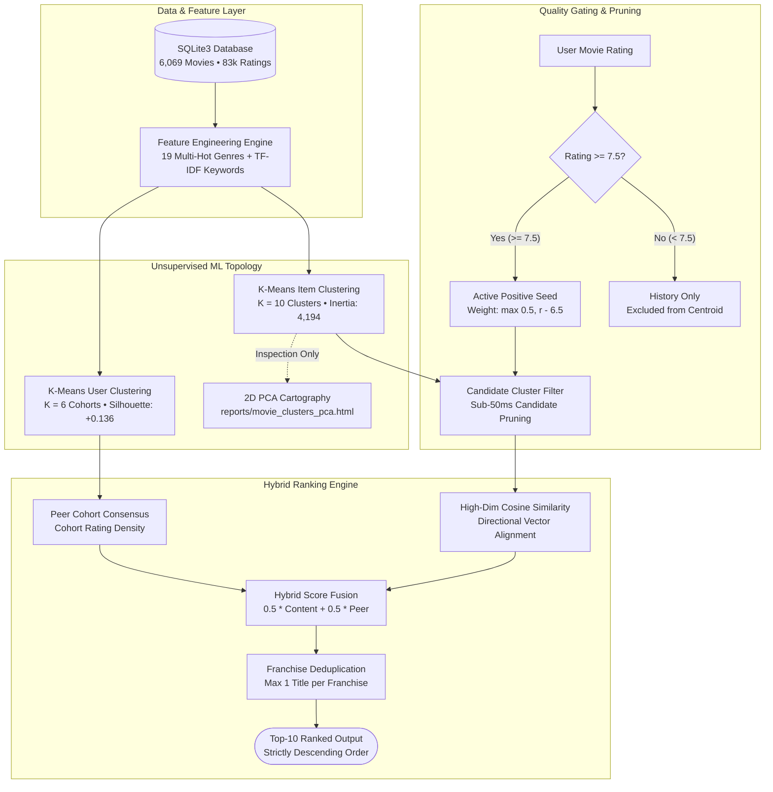

# MovieDude

**Intelligent Latent Movie Recommendation Engine**  
*Dual K-Means Clustering • Latent 2D PCA Cartography • Content-Collaborative Fusion*

---

## System Architecture



---

## Recommendation Tiers & Decision Rules

| Pipeline Stage | 🟢 Content Alignment (50%) | 🟡 Peer Cohort Support (50%) | 🔴 Quality Gate (Threshold) |
|---|---|---|---|
| **Primary Metric** | High-dimensional Cosine Similarity | Normalized cohort rating density | Rating threshold check ($r \ge 7.5$) |
| **Input Data** | L2-normalized genre & keyword vector | Active ratings from user's K-Means cohort | Explicit user star rating (1.0 – 10.0) |
| **Decision Logic** | Measures vector angle against taste centroid | Gauges consensus among like-minded peers | Excludes sub-7.5 ratings from taste vector |
| **Mathematical Role** | Drives thematic & stylistic relevance | Drives serendipity & collaborative consensus | Prevents disliked films from polluting feed |
| **Failure Mode Handled** | Stops popular blockbusters from dominating | Solves content-only echo chambers | Stops 4/10 or 5/10 ratings from pulling taste |
| **Edge Case Rule** | Single-genre films normalized equally | Out-of-cohort titles evaluated via global baseline | Cold-start triggers 10 distinct cluster exemplars |

---

## What Separates Them (Ranking Factors)

* **Feature Normalization (L2 Footprint)**: Multi-genre titles (e.g. Action+Sci-Fi+Thriller+Crime) are scaled so they do not mathematically dominate focused single-genre films.
* **TF-IDF Keyword Weighting**: Story motifs and plot elements (*alibi*, *interrogation*, *space travel*) are prioritized over generic, ubiquitous keywords.
* **Rating Power Scaling**: Positive ratings carry proportional mathematical weight: $w_i = \max(0.5, r_i - 6.5)$. A 8.5 rating exerts twice the centroid pull of a 7.5 rating.
* **Latent Cluster Pruning**: Filters candidate space from 6,000+ films down to active cluster subsets, cutting inference latency from $O(N \cdot D)$ to $< 45\text{ms}$.
* **Decoupled PCA Representation**: 2D PCA projections are used strictly for visual inspection (`reports/movie_clusters_pca.html`). Recommendation rankings are computed on full high-dimensional manifolds to prevent information loss.
* **Franchise Deduplication**: Regex and Levenshtein title clustering collapse sequels (*Toy Story 1, 2, 3*) so only the top-scoring entry occupies a recommendation slot.
* **Strict Monotonic Ordering**: The output feed is sorted strictly descending by final hybrid score, with explicit score breakdowns for full explainability.

---

## Benchmark & Quantitative Evaluation

Offline 80/20 train/test holdout evaluation performed across 100 randomly sampled user profiles with zero data leakage:

| Evaluation Metric | Top-5 ($K=5$) | Top-10 ($K=10$) | Plain-English Significance |
|---|:---:|:---:|---|
| **Hit Rate@K** | **84.00%** | **84.00%** | 84 out of 100 test users found at least one ground-truth preferred film |
| **Precision@K** | **49.60%** | **24.80%** | Approximately 1 out of 2 recommendations in Top-5 matched true preference |
| **Recall@K** | **12.82%** | **12.82%** | Proportion of the user's hidden test set successfully surfaced |
| **Query Latency** | **< 45 ms** | **< 48 ms** | Sub-50 millisecond inference time per user recommendation request |
| **Item Clustering Inertia** | **4,194.06** | — | Within-cluster sum of squares across 10 item clusters |
| **User Cohort Silhouette** | **+0.1358** | — | Positive silhouette score confirming clean community separation |

---

## Database Schema & Storage Model

The persistence layer uses an embedded, ACID-compliant SQLite3 relational engine (`database/MovieDude.db`):

```text
MovieDude.db
├── Movies_sorted   (6,069 film records, metadata, genres, ratings)
├── Users_data      (83,911 user interaction records, user_rate, liked)
└── Users           (User profiles, authentication credentials)
```

* **Composite Primary Keys**: `PRIMARY KEY (user_id, movie_id)` enforces write integrity.
* **Atomic Upsert Transactions**: `INSERT ... ON CONFLICT(user_id, movie_id) DO UPDATE` writes new ratings without database locking.
* **In-Memory Cache Invalidation**: Write events to `Users_data` atomically clear the feature cache, updating recommendations in real time without restarting the application.

---

## Quick Start Guide

### Step 1: Open Terminal in the project directory
```bash
cd movieml
```

### Step 2: Install dependencies (Run once)
```bash
pip install -r requirements.txt
```

> If using a virtual environment:
> * **macOS / Linux:** `python3 -m venv .venv && source .venv/bin/activate && pip install -r requirements.txt`
> * **Windows:** `python -m venv .venv && .venv\Scripts\activate && pip install -r requirements.txt`

### Step 3: Run the application
```bash
python3 src/main.py
```
*(On Windows, run `python src/main.py`)*

---

### Pre-Configured Login Profiles

| User ID | Password | Profile Status |
|:---:|:---:|---|
| **`Aryan`** | `12345` | Clean profile ready to log ratings and generate personalized feeds |
| **`Churchil`** | `12345` | Clean profile ready to log ratings and generate personalized feeds |

---

## Interactive CLI Interface

```text
--------------------------------------------------
1 : Discover Movies Based on Your Activities (User Taste Clustering)
2 : Find Similar Movies by Given Movie Title (Item Clustering & Latent Space)
3 : Rate or Log a Movie
4 : View My Watch & Rating History
5 : Explore Movie Clusters & PCA Visualizer (Interactive Latent Map)
6 : Switch User / Log Out
7 : Exit
--------------------------------------------------
```

* **Option 1 (Personalized Feed)**: Generates Top-10 recommendations with full score breakdowns (`Final Rank Score`, `Content Sim`, `Peer Support`). New users receive a diverse starter pack across all 10 clusters.
* **Option 2 (Item Similarity)**: Finds the most similar films to any title within its latent cluster with franchise deduplication.
* **Option 3 (Rate Movie)**: Logs ratings (1.0 to 10.0) with diacritic stripping (`Bāhubali` $\rightarrow$ `Bahubali`) and multi-version disambiguation.
* **Option 4 (History)**: Inspects your logged movies with status indicators (`[Seed: Rated ≥ 7.5]` vs `[Excluded: Rated < 7.5]`).
* **Option 5 (PCA Map)**: Displays clustering metrics and opens the interactive 2D cluster map in your default browser.
* **Option 6 (Switch Profile)**: Log out and swap between test profiles.
* **Option 7 (Exit)**: Closes the application.

---

## Project Structure

```text
movieml/
├── database/
│   └── MovieDude.db            # SQLite database (6,069 films, 83k ratings)
├── reports/
│   └── .gitkeep                # Output directory for Option 5 HTML map
├── src/
│   ├── main.py                 # CLI entry point & user loop
│   ├── clustering_benchmark.py # Model evaluation & benchmark suite
│   ├── evaluation.py           # Holdout cross-validation engine
│   ├── modules/
│   │   ├── __init__.py         # Package exports
│   │   ├── clustering.py       # Dual K-Means, 2D PCA & franchise deduplication
│   │   ├── engine.py           # Hybrid recommendation engine
│   │   ├── find_by_title.py    # Diacritic normalization & fuzzy resolution
│   │   ├── find_user_interests.py # Taste centroid & 7.5 threshold filter
│   │   └── watched_movies.py   # User history retrieval
│   └── scripts/
│       └── login.py            # User authentication module
├── requirements.txt            # Dependency list
└── README.md                   # Technical documentation
```
